# Smart Office Seat & Co-working Space Allocation System

**Course:** ETCCMS304 — Database Management Systems (B.Tech. CSE, Semester III)  
**Project:** Project 3 (DBMS Capstone) | **Database:** MySQL 8.0 (InnoDB) + MongoDB  
**Team Members:** Shreshth Kumar Chaudhary (2501010080) • Shreyansh Kumar (2501010019) • Nitin (2501010014)  
**Faculty Mentor:** Dr. Deepika Garg | **Submission Date:** 26 November 2026  

🌐 **Live 24/7 Production URL:** [https://smart-office-system.onrender.com](https://smart-office-system.onrender.com)  
🗄️ **Cloud Database:** Aiven Managed MySQL 8.4 (InnoDB, Triggers, Stored Procedures, ACID)  

---

## 📸 Visual Showcase & Execution Screenshots

### 1. Conceptual Design: Enhanced ER (EER) Diagram
Comprehensive entity-relationship model with supertype/subtype hierarchy (`Resource` $\to$ `Desk` / `Room`), 13 normalized tables (3NF/BCNF), composite relationships, and audit tracking.

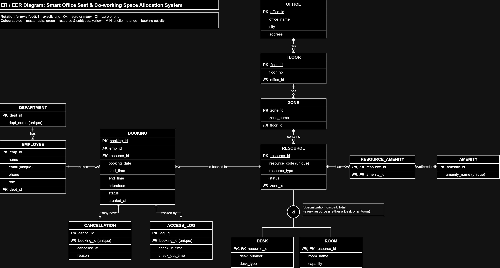

---

### 2. Web Application (Frontend + Backend)
Interactive Python Flask web application connecting via least-privilege MySQL role (`emp_5`), parameterized `%s` queries, dynamic availability lookup (`fn_is_available`), and transaction-safe stored procedure booking (`sp_book_resource`).

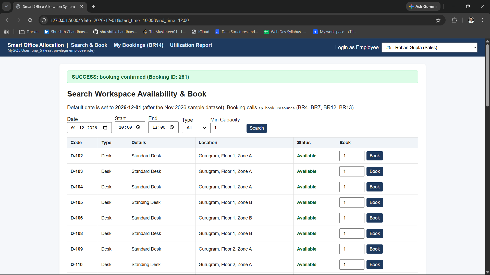

---

### 3. Security: Role-Based Access Control (RBAC) & BR14
Least-privilege enforcement across 4 roles (`employee`, `facility_manager`, `security`, `admin`). Employees cannot directly insert or modify bookings; personal booking isolation (BR14) is enforced dynamically through MySQL session function `USER()` inside view `v_my_bookings`. Direct table modifications fail with `Error Code: 1142`.

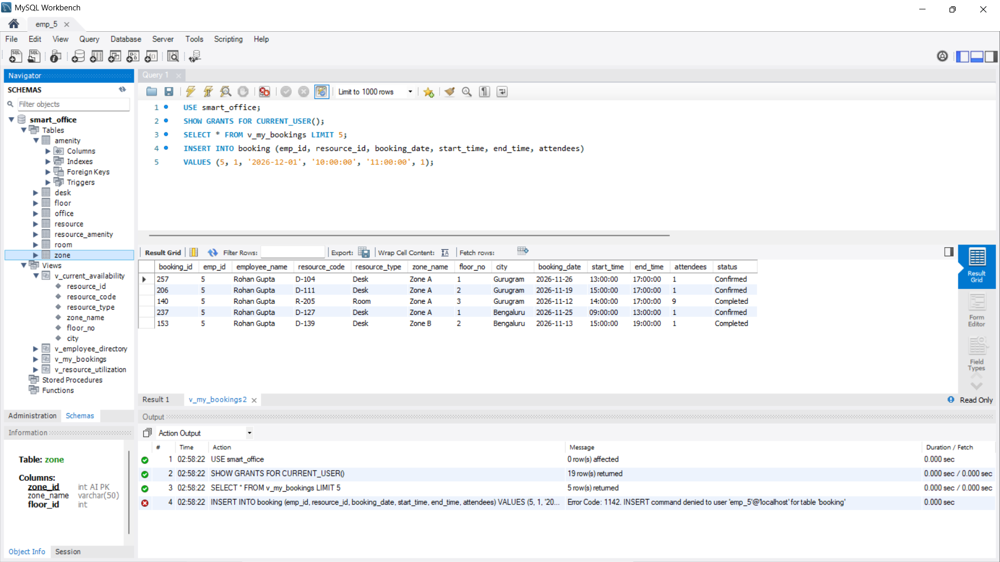

---

### 4. Security: SQL Injection Defense (Vulnerable vs. Parameterized)
Side-by-side demonstration using payload `' OR '1'='1`: vulnerable dynamic concatenation leaks all 47 resources, while parameterized query safely neutralizes the attack (0 rows returned). Stored procedures (`callproc`) execute safely with malicious input handled strictly as literal strings.

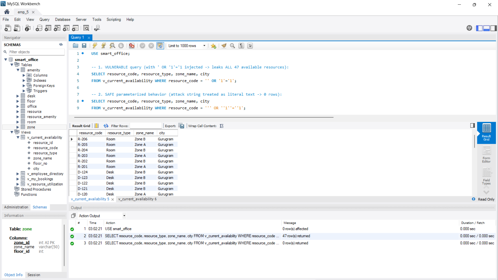

---

### 5. NoSQL Extension: MongoDB (`smart_office_nosql`)
Polyglot persistence model: ACID booking transactions in MySQL 8.0 combined with flexible, schema-free hardware and IoT sensor metadata in MongoDB (`workspace_config` collection, 50 documents, compound & multikey indexes, and aggregation pipelines).

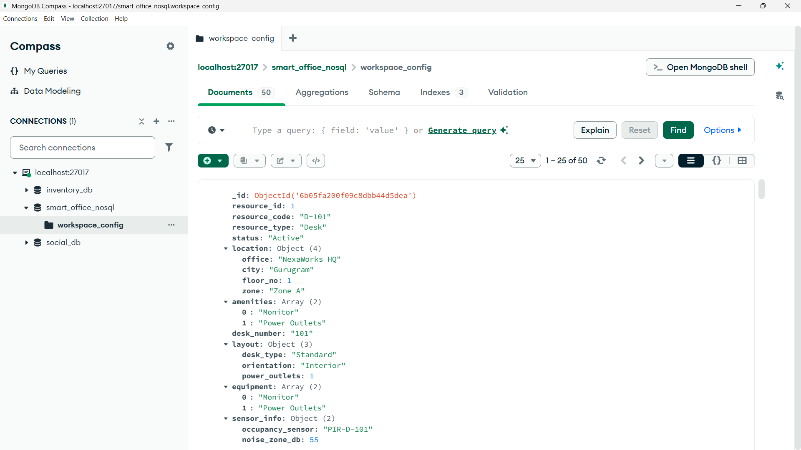

---

### 6. Automated Verification: 22/22 Test Cases Passed
Automated Python test harness verifying positive flows, business rule boundary conditions (BR1–BR14), schema integrity constraints (PK/FK/UNIQUE/CHECK), ACID transactions (COMMIT/ROLLBACK/SAVEPOINT), and concurrent booking collisions with zero database drift.

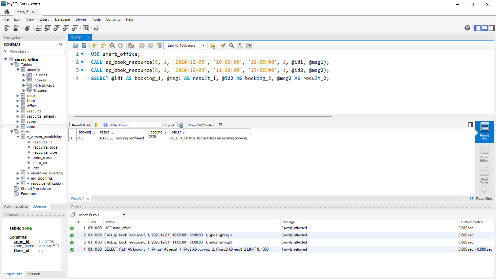

---

### 7. Transactions, Concurrency & Deadlock Control (BR5)
Real two-session concurrency testing demonstrating the double-booking problem under `REPEATABLE READ`, the locking solution via `SELECT ... FOR UPDATE` inside `sp_book_resource`, and mutual exclusion deadlock handling (`Error Code: 1213`).

| Transaction SAVEPOINT Demo | Concurrency: Session B Lock Waiting |
| :---: | :---: |
| 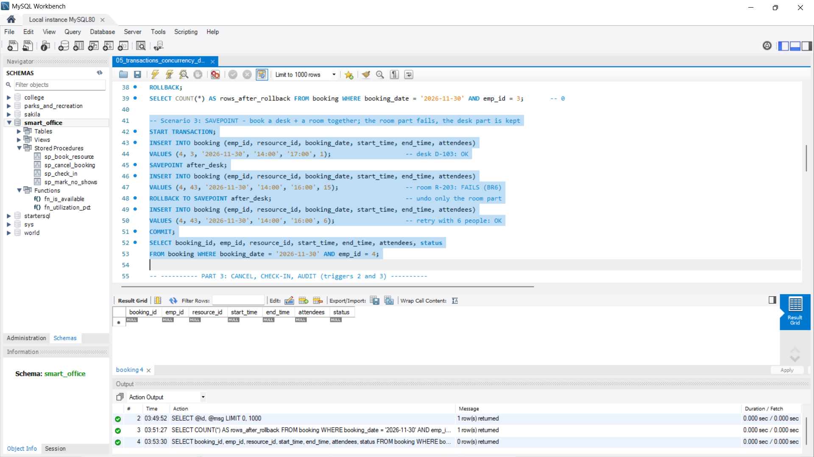 | 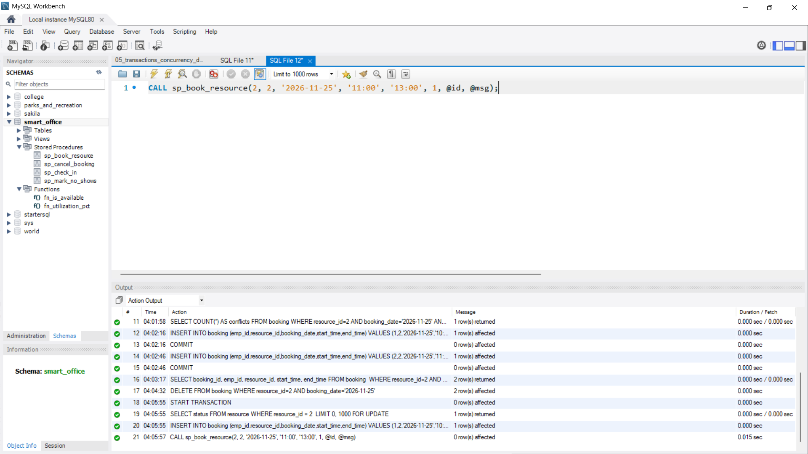 |

| Concurrency: Serialization After COMMIT | Concurrency: Deadlock Detection (Error 1213) |
| :---: | :---: |
| 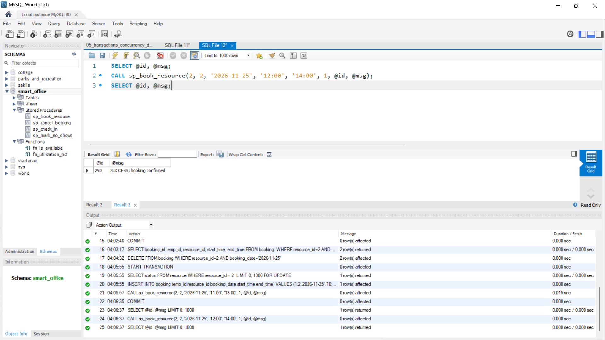 | 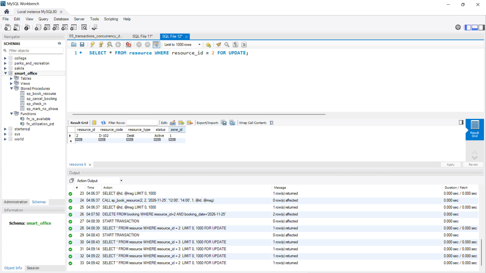 |

---

### 8. SQL Implementation, Views & Index Optimization (EXPLAIN)
13 InnoDB tables, ~743 sample records, 19 complex analytical queries, 4 views, and B-Tree index optimizations verified with `EXPLAIN` query execution plans.

| Schema & Constraints DDL | Window Functions & Ranking |
| :---: | :---: |
|  | 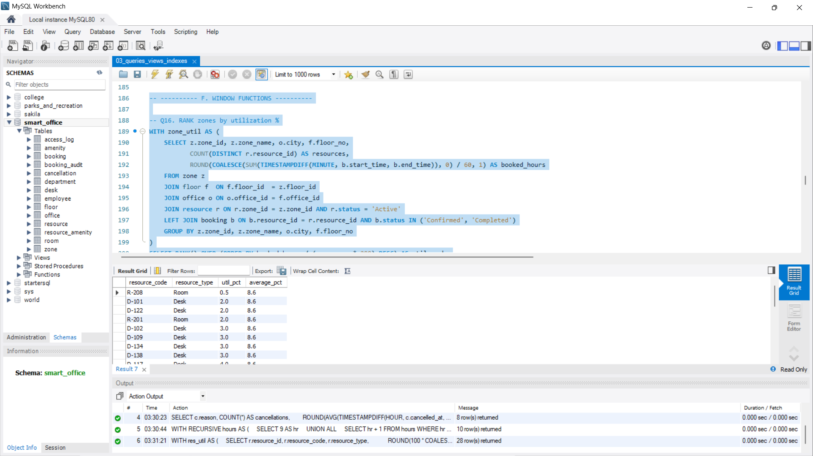 |

| Database Views Verification | Index Optimization & EXPLAIN Plan |
| :---: | :---: |
| 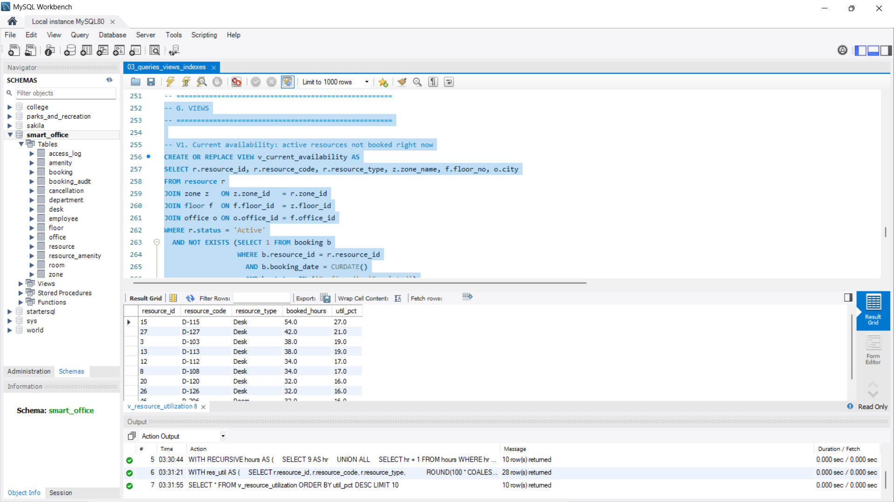 | 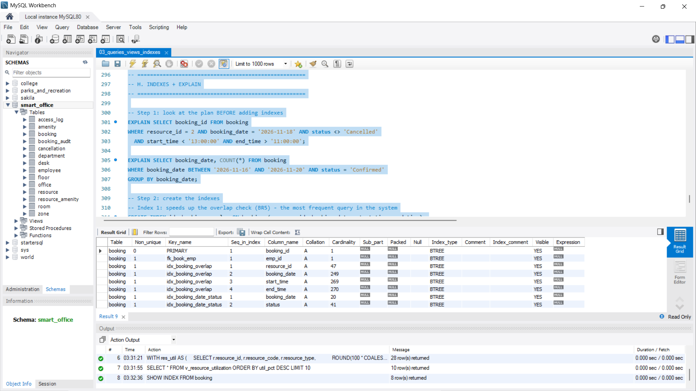 |

---

## 🚀 How to Run Everything From Scratch (In Order)

### Prerequisites
- **MySQL 8.0** running on `localhost:3306` with `mysql.exe` on PATH
- **MongoDB** running on `localhost:27017` (local service or MongoDB Atlas)
- **Python 3.10+** (verified on Python 3.14.2)

### Step 1 — Configure `.env` and Python Environment
```powershell
# Copy template and set your credentials
copy .env.example .env

# Virtual environment setup
python -m venv .venv
.\.venv\Scripts\Activate.ps1
pip install -r app\requirements.txt pymongo python-docx python-pptx
```

### Step 2 — Load Core MySQL Database (`01`–`05`)
Execute in MySQL Workbench or via `mysql.exe` in this order:
1. `sql-commands/01_ddl.sql` — Creates `smart_office` schema and 13 InnoDB tables with constraints.
2. `sql-commands/02_data.sql` — Populates realistic dataset (~743 records covering Nov 2–27, 2026).
3. `sql-commands/03_queries_views_indexes.sql` — Executes 19 analytical queries, 3 views, and 2 B-Tree indexes with `EXPLAIN`.
4. `sql-commands/04_triggers_procedures_functions.sql` — Creates `booking_audit`, 3 triggers, 2 functions, and 4 stored procedures.
5. `sql-commands/05_transactions_concurrency_demo.sql` — Executes COMMIT, ROLLBACK, SAVEPOINT, and 2-session concurrency/deadlock scripts.

### Step 3 — RBAC & Least-Privilege Security (T1)
```powershell
Get-Content "sql-commands\06_rbac_security.sql" -Raw | & "C:\Program Files\MySQL\MySQL Server 8.0\bin\mysql.exe" -h localhost -P 3306 -u root -p
.\.venv\Scripts\python.exe sql-commands\06_rbac_test.py
```
*Output captured in `sql-commands/06_rbac_test_output.txt`.*

### Step 4 — SQL Injection Defense Demo (T2)
```powershell
.\.venv\Scripts\python.exe 07_sql_injection_demo.py
```
*Output captured in `07_sql_injection_output.txt`.*

### Step 5 — MongoDB NoSQL Extension (T3)
```powershell
# Ensure MongoDB service is running (Start-Service MongoDB)
.\.venv\Scripts\python.exe 08_mongodb\export_from_mysql.py
.\.venv\Scripts\python.exe 08_mongodb\mongo_demo.py
```
*Output captured in `08_mongodb/mongo_demo_output.txt`. (Equivalent mongosh script: `08_mongodb/mongosh_demo.js`.)*

### Step 6 — Launch Flask Web Application (T4)
```powershell
.\.venv\Scripts\python.exe app\app.py
```
*Open `http://127.0.0.1:5000` in Google Chrome or any modern browser.*

### Step 7 — Run Automated Test Suite (T5)
```powershell
.\.venv\Scripts\python.exe 09_tests\run_tests.py
```
*Executes 22 test cases (positive, negative, integrity, transactions, and multi-threaded concurrency), producing `09_tests/test_results.csv` and `09_tests/test_results.md`.*

---

## 📋 Deliverables Map (Project 3 Brief → Code & Screenshots)

| Brief Deliverable | File(s) in Workspace | Report Section | Embedded Screenshot |
|---|---|---|---|
| **Requirements & business rules (BR1–BR14)** | `DBMS_Capstone_Report_Final.docx` | Phase 1 | Tables 1–8 in Report |
| **ER / EER diagram & relational schema** | `smart_office_ER_diagram.drawio`, `sql-commands/01_ddl.sql` | Phase 2 & 3 | `screenshots/smart_office_ER_diagram.drawio.png` |
| **Functional dependencies & normalization (3NF/BCNF)** | `DBMS_Capstone_Report_Final.docx` | Phase 3 | Step-by-step proofs in Report |
| **SQL DDL & realistic dataset (10+ tables, 200+ rows)** | `sql-commands/01_ddl.sql`, `02_data.sql`, `generate_data.py` | Phase 4.1–4.2, Appendix A | `screenshots/SQL scripts + schema.png`, `quick-constraint-test.png`, `Dataset.png` |
| **Complex query set (joins, subqueries, set ops, CTEs, windows)** | `sql-commands/03_queries_views_indexes.sql` | Phase 4.3, Appendix B | `screenshots/03_q1_q5_joins.png` to `03_q16_q19_windows.png` |
| **Views, indexes, triggers, procedures, functions** | `sql-commands/03_queries_views_indexes.sql`, `04_triggers_procedures_functions.sql` | Phase 4.4–4.5, Phase 5.1, Appendix C | `screenshots/03_views.png`, `03_indexes_explain.png`, `04_triggers_procedures_functions.png` |
| **Transaction & two-session concurrency demo** | `sql-commands/05_transactions_concurrency_demo.sql` | Phase 5.4–5.6, Appendix D | `screenshots/05_tx_commit.png`, `05_tx_savepoint.png`, `05_demo1_double_booking.png`, `05_demo2_after_commit.png`, `05_demo3_deadlock.png` |
| **RBAC & SQL-injection prevention demo** | `sql-commands/06_rbac_security.sql`, `06_rbac_test.py`, `07_sql_injection_demo.py` | Phase 6, Appendix E & F | `screenshots/06_rbac_workbench.png`, `screenshots/07_sql_injection_workbench.png` |
| **NoSQL (MongoDB) + Application integration (CO4)** | `08_mongodb/*`, `app/*` | Phase 7, Appendix G & H | `screenshots/08_mongodb_compass.png`, `screenshots/app_flask_booking.png` |
| **Testing (20+ cases: positive, negative, integrity, tx, concurrency)** | `09_tests/run_tests.py`, `test_results.csv`, `test_results.md` | Phase 8, Appendix I | `screenshots/09_test_results.png` |
| **Final report, presentation & viva prep** | `DBMS_Capstone_Report_Final.docx`, `DBMS_Capstone_Presentation.pptx`, `viva_qa.md` | Full Project | Complete Documentation Suite |
